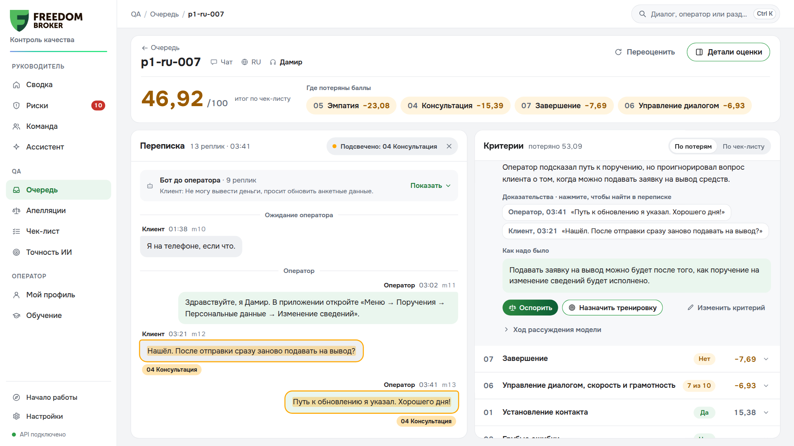
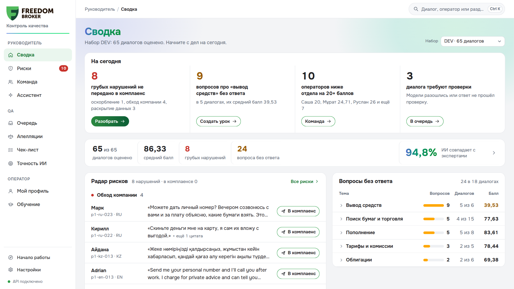
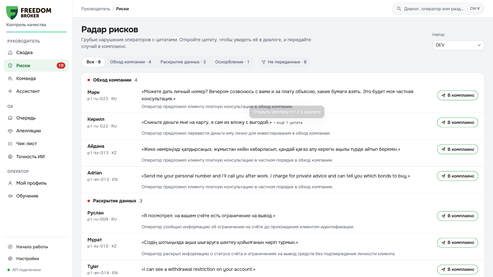
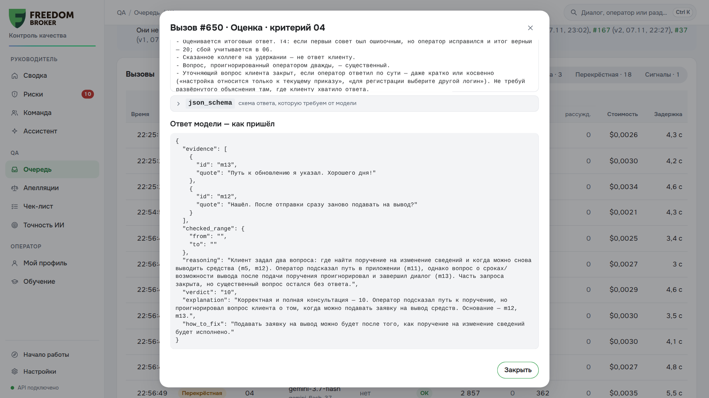
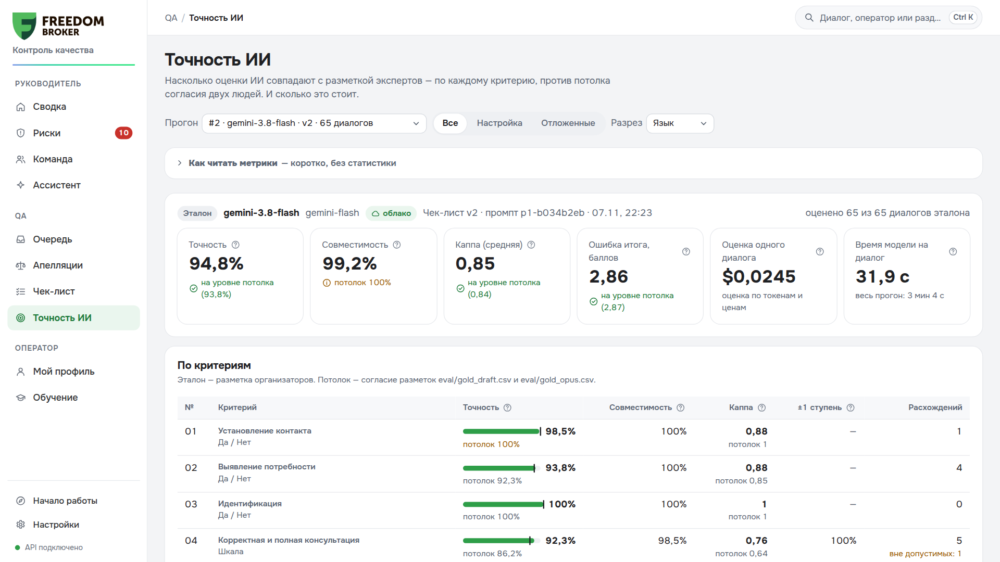
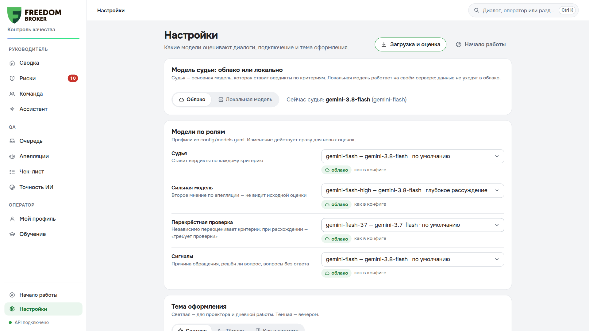

# CQA — Conversation Quality Analytics · команда DepaTeam

Прототип для хакатона Freedom Broker. Система оценивает чаты и звонки операторов по настраиваемому чек-листу:
- у каждой оценки — реплика-доказательство;
- оценку можно оспорить, проверяющий принимает решение;
- критерий можно изменить в интерфейсе и применить к диалогам.

**Результаты для организаторов:** [results/dev/results.json](results/dev/results.json) — DEV (65 диалогов), [results/prod/results.json](results/prod/results.json) — контрольный набор FBroker (10 чатов). Формат JSON 1.0 из приложения к гайду. Оценки получены системой без ручных правок: Gemini 3.8 Flash, чек-лист v2 заморожен до контроля.

- **Как пользоваться — все функции по экранам: [docs/guide.md](docs/guide.md)**
- Проверка всего функционала по шагам: [docs/walkthrough.md](docs/walkthrough.md)
- План проекта: [docs/plan.md](docs/plan.md)
- Ядро оценки (подход, трактовки, качество): [docs/core-eval.md](docs/core-eval.md)
- Спецификация реализации: [docs/implementation.md](docs/implementation.md)
- Задание и чек-лист организаторов: [docs/task.txt](docs/task.txt), [docs/checklist.txt](docs/checklist.txt)

## Как это выглядит

**Карточка диалога.** Итог и «где потеряны баллы». Клик по критерию подсвечивает реплику-доказательство в переписке; рядом объяснение, «как надо было», кнопки «Оспорить», «Назначить тренировку», «Изменить критерий».



**Сводка руководителя.** Дела на сегодня, радар рисков с цитатами и передачей в комплаенс, вопросы клиентов без ответа по темам, совпадение ИИ с экспертами.



**Радар рисков.** Все грубые нарушения (обход компании, раскрытие данных, оскорбление) с цитатой и объяснением. Клик открывает диалог на этой реплике.



**Журнал модели.** У каждой оценки виден каждый вызов: полный запрос, схема ответа и ответ как пришёл (цитаты → рассуждение → вердикт), токены, цена, задержка. Система действительно анализирует диалог.



**Точность ИИ.** Совпадение с эталоном по каждому критерию против потолка согласия двух экспертов, ошибка итога, стоимость и время. Разрезы по языкам и отложенным сценариям.



**Настройки.** Судья — облако (Gemini) или локальная модель (Gemma 4); модели по ролям. Ключи показываются только как «задан / не задан».



## Возможности

| Роль | Что есть |
| --- | --- |
| **QA** | очередь диалогов, худшие сверху; карточка: вердикт, цитата-доказательство (клик → реплика, у звонка — перемотка записи), «как надо было», журнал каждого вызова модели; апелляции со «вторым мнением ИИ» вслепую и решением в одну кнопку; редактор чек-листа: изменить, добавить критерий, поменять вес → пробный прогон на 10 диалогах «было/стало» → применить ко всем (пересчитывается только изменённый критерий); прецеденты из апелляций → пример в чек-листе; экран «Точность ИИ»: совпадение с эталоном, автотесты судьи, устойчивость к инъекции |
| **Руководитель** | сводка «На сегодня»; радар рисков: грубые нарушения с цитатами и передачей в комплаенс; вопросы клиентов без ответа по темам; причины обращения; команда и срезы по языку, каналу, оператору; ассистент: вопрос обычным языком → SQL только на чтение → ответ со ссылками на диалоги |
| **Оператор** | профиль: зоны роста с примерами; тренажёр: ИИ играет клиента из провального диалога, потом «было/стало» по тому же чек-листу; тьютор со ссылками на лучшие ответы коллег |
| **Звонки** | плеер над расшифровкой: клик по доказательству перематывает запись на эту секунду; участки «удержание — клиент не слышит» и «вне записи» выделены; mp3 скачиваются при загрузке и отдаются через бэкенд |
| **Ещё для QA** | перекрёстная проверка второй моделью → пометка «требует проверки»; «Переоценить» диалог (без изменений — из кэша); версии чек-листа и построчное сравнение любых двух версий; «Загрузка и оценка»: набор из API, оценка с оценкой стоимости заранее, история прогонов, повтор упавших; экспорт CSV (исходная оценка и с учётом апелляций), полный JSON и формат сдачи `results.json` |
| **Ещё для руководителя и оператора** | сигналы диалога: причина обращения, решён ли вопрос, вопросы без ответа; «Уроки для всех» — тренировка команды на диалогах темы; ручное назначение оператора звонкам без имени; «Сводка от ИИ» в профиле оператора; тьютор честно отвечает «нет информации», если ответа нет в данных |
| **Платформа** | облако (Gemini) или локальная модель (Gemma 4 через Ollama) — переключатель в настройках; модели по ролям (судья, сильная модель, перекрёстная проверка, сигналы); кэш и журнал всех вызовов с ценой; песочницы — пробный прогон и эксперименты не меняют текущие оценки; один HTML-файл для Dynamics 365; поиск Ctrl+K, путеводитель «Начало работы» по ролям, пояснения терминов, тёмная тема, адаптация под телефон, демо-режим без сервера; CLI `cqa` на все операции |

## Быстрый старт

Нужны Python 3.12 и [uv](https://docs.astral.sh/uv/). `ffmpeg` нужен, только чтобы сверять длительность аудио.

```bash
uv sync
cp .env.example .env        # вписать CQA_API_URL (ссылка из гайда) и GEMINI_API_KEY
uv run cqa load --group DEV # загрузить набор из API организаторов (mp3 звонков скачиваются сразу)
uv run cqa serve            # http://127.0.0.1:8000 — интерфейс и API
```

Без ключей и сети:

```bash
uv run cqa serve --fake     # детерминированная «модель» для демо интерфейса
uv run cqa ui-preview       # только фронтенд на мок-данных: http://127.0.0.1:8090/?mock=1
```

## Оценка и точность

```bash
uv run cqa eval --group DEV --gold eval/gold.csv              # прогон → экспорт → метрики на эталоне
uv run cqa eval --group DEV --gold eval/gold.csv --split holdout
uv run cqa evaluate DEV:p1-ru-022                             # один диалог, вердикты в консоль
uv run cqa export --group DEV --format csv --out results.csv  # для сверки с эталоном
uv run cqa log --last                                         # журнал вызовов модели
```

- **Модель** — Gemini 3.8 Flash (`config/models.yaml`). Один вызов на критерий; всё остальное делает код: подготовка диалога, проверка цитат, подсчёт баллов.
- **Стоимость** одной оценки диалога со всеми вызовами — около **$0.024** (Gemini 3.8 Flash: $0.75 / $3.75 за 1M входных и выходных токенов).
- **Точность на DEV** против эталона из двух независимых разметок — на уровне согласия разметчиков между собой:
  - ошибка итога (MAE) 2,86 балла при потолке 2,87 (расхождение двух разметчиков);
  - на отложенных семьях сценариев, на которых промпт не настраивали, — 2,00;
  - совпадение по критериям: 01 98%, 02 94%, 03 100%, 04 92%, 05 95%, 06 86%, 07 92%, 08 100%;
  - ловушки 100%, автотесты судьи 103 из 105.

  Подробно — `docs/core-eval.md` §5.

## Контрольный этап

```bash
uv run cqa freeze                                   # зафиксировать версию чек-листа и модель
uv run cqa load --group FBroker                     # набор из API организаторов
uv run cqa eval --group FBroker --frozen            # оценка: 10 чатов за ~50 с, $0.25
uv run cqa results --group FBroker --team DepaTeam --out results/prod/results.json --expect 10
```

`cqa results` пишет формат JSON 1.0 и сам его проверяет:
- все 8 критериев, допустимые значения;
- нет дублей и пропусков, ID совпадают с API;
- `critical_flag` совпадает с `critical`;
- неоценённый диалог попадает в файл со `status: "error"`.

`evidence_turns` — номера реплик по исходному массиву транскрипта: реплика `mN` у нас — это ровно N-й элемент.

**Репетиция на DEV** (10 диалогов, новая группа, без кэша): загрузка, оценка и экспорт — около 1–4 минут и $0.26. Замена критерия 07 на «Обращение к клиенту по имени» и применение к 10 диалогам — 12 секунд и $0.03: пересчитывается только новый критерий.

**Замена критерия:** в интерфейсе «Чек-лист» → изменить или добавить критерий → «Сохранить как новую версию» → «Сделать активной» → «Применить к диалогам». Пересчитывается только изменённый критерий, остальное берётся из кэша.

## Локальная модель

Gemma 4 на ноутбуке с RTX 4060 (8 ГБ) через Ollama, OpenAI-совместимый API. Профили `local` (Gemma 4 26B-A4B) и `local-12b` (Gemma 4 12B) — в `config/models.yaml`. Судью можно переключить в «Настройках» или флагом `--profile`.

```bash
ssh -N -L 11435:127.0.0.1:11434 home &              # туннель к Ollama на ноутбуке
LOCAL_LLM_BASE_URL=http://127.0.0.1:11435/v1 uv run cqa llm-ping --profile local-12b
LOCAL_LLM_BASE_URL=http://127.0.0.1:11435/v1 uv run cqa eval --group DEV --profile local-12b --experiment --gold eval/gold.csv
```

**Замер Gemma 4 12B** — 6 отложенных диалогов, на которых промпт не настраивали:
- совпадение с эталоном 46 из 48 оценок, ошибка итога 3,82 балла (Gemini на тех же диалогах — 0);
- все ловушки верно, сбоев 0;
- ~20 с на вызов, ~2,7 мин на диалог на RTX 4060.

Вывод: основной судья — Gemini, локальная модель — режим «без интернета, данные внутри контура».

Ollama молча обрезает промпт, если он длиннее `num_ctx`. Тогда модель «оценивает» диалог, которого не видела. Адаптер сверяет число токенов промпта с длиной текста и с `num_ctx` сервера и помечает такой ответ как обрезанный. Подробно — `docs/core-eval.md` §7.

## Устройство

| Каталог | Что внутри |
| --- | --- |
| `cqa/ingest` | загрузка из API, нормализация (участки, удержание, паузы записи, события), факты, аудио |
| `cqa/checklist` | чек-лист: YAML ⇄ версии в БД, diff |
| `cqa/core` | промпт, судья по критерию, проверка цитат, скоринг, пакетный прогон |
| `cqa/llm` | шлюз к моделям (кэш, повторы, лимиты, журнал, стоимость): Gemini, OpenAI-совместимый (локальная модель), fake |
| `cqa/api`, `cqa/appeals` | REST API, апелляции, фоновый воркер |
| `cqa/quality` | метрики на эталоне, автотесты судьи |
| `frontend/` | интерфейс: vanilla JS + web components, сборка в один HTML (`cqa build-ui`) для web resource Dynamics 365 |
| `eval/` | эталон DEV (`gold.csv`), отложенные семьи сценариев, сравнение разметок |

**Встраивание в Dynamics 365:** `build/cqa.html` загружается как web resource, адрес API передаётся параметром `data={"apiBase":"https://…"}`.

## Секреты

Ссылка API и `audio_url` содержат подпись `sig=`, а `.env` — ключ модели. Поэтому:
- `.env` и `data/` в git не попадают;
- pre-commit хук (`.githooks/`) блокирует коммит с подписью или ключом;
- аудио отдаётся только через бэкенд, ссылки организаторов наружу не выходят.

## Тесты

```bash
uv run pytest -q
```
