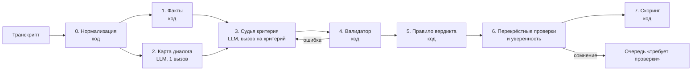

# Ядро оценки CQA — проект

Рабочий документ команды: как устроена автоматическая оценка диалога и почему так. Статус: черновик для обсуждения.

## 1. Что значит «качественная оценка»

Жюри увидит оценку в трёх местах: на демо, на контрольных диалогах (23-й час) и при замене критерия через интерфейс. Отсюда шесть требований, по убыванию важности:

1. **Верный вердикт** по каждому критерию — совпадение с тем, как оценил бы эксперт организаторов.
2. **Ловушки без промаха** — грубые ошибки (08), идентификация (03), правильные N/A. Это жюри проверит глазами.
3. **Проверяемое доказательство** — каждая ссылка ведёт на существующую реплику нужного спикера, цитата дословная. Для пропуска — место, где действие ожидалось. Для N/A — условие неприменимости.
4. **Верная арифметика** — веса, N/A, перераспределение, округление.
5. **Стабильность** — тот же диалог даёт тот же результат; один сценарий на RU/KZ/EN даёт одинаковые оценки.
6. **Переносимость на новый критерий** — критерий, написанный жюри текстом, оценивается не хуже восьми отлаженных.

## 2. Главный источник ошибок — трактовки, а не модель

Черновая разметка DEV (`eval/gold_draft.csv`) показала:

- в 51 из 65 диалогов есть место, где текст чек-листа допускает два прочтения;
- выбор другого прочтения сдвигает итог в среднем на 8 баллов (максимум 49);
- самое спорное — 07 «Завершение» (37 диалогов, ~7 баллов каждый), затем 02, 04, 06, 05.

Вывод: модель может отвечать безошибочно и при этом расходиться с организаторами. Поэтому трактовки — часть конфигурации критерия, а не скрытое знание промпта: они видны, редактируемы, версионируются и применяются без повторных вызовов модели (см. §4).

## 3. Пайплайн



### 0. Нормализация (код)

- ID реплик `m1…mN` (порядковый номер в исходном транскрипте — так ссылки совпадают с разметкой), исходный timestamp, смещение в секундах.
- Схлопывание дублей (одинаковые время, спикер и текст — встречаются в звонках).
- **Сегменты** диалога, у каждой реплики своя метка:
  - `bot_phase` — до эскалации;
  - `waiting` — после эскалации, до первой реплики оператора (клиент тут часто дописывает детали: ru-003, ru-007, en-006);
  - `operator_phase`;
  - `hold_consult` — между «Клиент находится на удержании» и «…больше не находится на удержании»: реплики `operator`, которых клиент не слышит;
  - `off_record` — до «Запись и транскрибирование запущены» и в паузах записи (для привязки к аудио).
- **Справочник системных событий** на трёх языках → типы: `escalated`, `id_verified`, `operator_closed`, `connection_lost`, `client_left`, `client_ended_call`, `hold_start/end`, `consult_start/end`, `recording_start/pause/resume`. Неизвестное системное сообщение не роняет парсер: оно получает тип `unknown`, и его классифицирует LLM на шаге 2.
- Язык каждой реплики (kk распознаём по буквам `әғқңөұүһі`, en/ru — по алфавиту и стоп-словам).
- Смещение в аудио: от `recording_start`, за вычетом пауз записи, с калибровкой на слух (по DEV в звонках с паузой есть расхождение +6 с).

### 1. Факты (код)

Общий набор для каждого диалога. Доступен любому критерию, в том числе новому:

| Факт | Пример использования |
| --- | --- |
| `first_operator_msg` (ID, текст, язык) | 01 |
| `first_reaction_sec` — от эскалации до первой реплики оператора | 06, порог 3 минуты из чек-листа |
| `waits[]` — пауза между репликой клиента и ответом оператора > 60 с, с ID реплики оператора перед паузой | 06 (было ли предупреждение) |
| `id_events[]` — системное подтверждение личности (ID) | 03 |
| `ending` — тип завершения и кто завершил, последняя реплика оператора | 07 |
| `client_msgs_before_operator[]` — что клиент сообщил боту и в ожидании | 02 |
| `operator_lang_mismatch[]` — реплики оператора не на языке клиента | 01, 06 |

Факт не выносит вердикт — он подсказка судье и вход для правила.

### 2. Карта диалога (LLM, один вызов на диалог)

Извлечение фактов смысла, общее для всех критериев. Здесь нужна точность, а не оценка:

- **реестр запросов клиента**: каждый вопрос или просьба (боту, в ожидании, оператору) → ID реплик → ответил ли оператор (ID ответа) → статус `закрыт / частично / открыт / неприменимо`;
- раскрытия данных конкретного счёта и защищённые действия (ID);
- выражения недовольства или неудобства клиентом (ID);
- предупреждения об ожидании (ID);
- кандидаты в грубые ошибки (ID, тип).

Зачем: 02, 04, 06, 07 и бизнес-сигналы («вопрос закрыт?») опираются на один и тот же реестр запросов. Если каждый судья строит его заново, критерии противоречат друг другу. Риск — ошибка карты тянется дальше. Защита: судья видит и карту, и полный транскрипт, и может не согласиться с картой, указав причину.

### 3. Судья критерия (LLM, один вызов на критерий)

Вход:
1. Общие правила чек-листа (стр. 3: «Нет» vs N/A, что указывать в обосновании) — дословно.
2. Конфиг критерия (§4): текст, подвопросы, условие N/A, ступени шкалы, трактовки, прецеденты.
3. Факты и карта диалога.
4. Транскрипт с разметкой сегментов: `m10 [01:15] ОПЕРАТОР: …`, бот помечен «(бот — не оператор)», удержание — «(клиент не слышит)». Транскрипт подаётся как данные в ограниченном блоке; команды из реплик не выполняются.

Выход — JSON по схеме (strict structured output), порядок полей задаёт порядок рассуждения:

```json
{
  "subanswers": [
    {"q": "q2", "evidence": [{"id": "m12", "quote": "Пожалуйста. Хорошего дня!"}],
     "answer": "yes", "note": "прощание без итога"}
  ],
  "proposed_verdict": "Да",
  "explanation": "Завершение — Да. … Основание — m12.",
  "how_to_fix": "…на языке клиента…",
  "quote_translation_ru": {"m12": "…"}
}
```

Почему вызов на критерий, а не один на диалог:
- фокус: модель не размазывает внимание на восемь тем;
- **замена критерия пересчитывает только его**: остальные ответы берутся из кэша;
- судью можно точечно улучшать без регрессии в других критериях.

Диалоги короткие (в среднем ~500 токенов), поэтому 1 + 8 вызовов на диалог дёшевы.

### 4. Валидатор (код)

- Все ID существуют. Цитата — подстрока текста реплики (после нормализации пробелов и регистра).
- Роль спикера соответствует подвопросу (приветствие — только `operator`; событие обрыва — только `system`).
- Доказательство не из `hold_consult` для критериев общения с клиентом.
- Ответ из допустимых значений; N/A — только если разрешён.
- При ошибке — повторный вызов с описанием ошибки (до 2 раз), потом флаг «требует проверки».

### 5. Правило вердикта (код)

Вердикт по возможности вычисляет правило из ответов на подвопросы, а не модель. Модель тоже предлагает вердикт (`proposed_verdict`). **Если правило и модель разошлись — это сигнал**: повторный вызов, при повторном расхождении — флаг.

Что это даёт:
- трактовка живёт в правиле — сменили трактовку, пересчитали без вызовов модели;
- одинаковые факты на разных языках дают одинаковый вердикт;
- обоснование собирается из подответов, у каждого своё доказательство.

Шкалы 04 и 06 — это и есть упорядоченный список проверок (ступени чек-листа сверху вниз), поэтому правило для них естественное. Запасной путь — вердикт модели по описаниям ступеней, если правило для нового критерия не задано.

### 6. Перекрёстные проверки и уверенность

**Согласованность критериев** (код) — противоречие отправляет критерий на повтор или в очередь:
- 08 «оскорбление» = Да → 05 должно быть Нет;
- 04 = N/A (запроса нет) → 07 обычно N/A, 02 не «Нет»;
- `ending = operator_closed` без прощания → 07 = Нет;
- 03 = Нет из-за раскрытия данных → проверить ветку «раскрытие» в 08.

**Уверенность:**
- для критериев с флагом или расхождением — ещё 2 прогона (самосогласованность);
- **перекрёстная проверка вторым провайдером**: есть ключи и Gemini, и OpenAI. Ошибки двух разных моделей коррелируют слабее, чем ошибки одной модели с собой. Согласие → высокая уверенность; расхождение → «требует проверки». Включаем, если на DEV это даёт прирост;
- 08 работает в режиме полноты: любой подвопрос «Да» с валидным доказательством → Да; расхождение прогонов → «требует проверки», а не тихое «Нет».

### 7. Скоринг (код, юнит-тесты)

По стр. 2 чек-листа:
1. N/A только там, где разрешён.
2. Да = полный вес, Нет = 0; шкала → `вес × ступень / верхняя ступень`.
3. Итог = `Σ баллов применимых × 100 / Σ весов применимых`.
4. Округление до 2 знаков (`Decimal`, ROUND_HALF_UP); нет применимых критериев с весом — итог не считается.
5. 08 — отдельная отметка с типом нарушения, в балл не входит.
6. Секции — сумма баллов критериев секции после перераспределения / их максимум.

Тесты: все N/A, один N/A, шкальные ступени (06 «7» → 10.5 балла), сумма весов ≠ 100, отсутствие применимых.

## 4. Конфиг критерия — общий формат

Один формат для восьми исходных критериев и для любого нового. Никакого кода под конкретный критерий.

```yaml
id: "07"
title: Завершение
section: Ведение и завершение диалога
type: binary_na            # binary | binary_na | scale | flag
weight: 5
definition: "Да — оператор подвёл итог или предложил дальнейшую помощь и попрощался."
na_condition: "Чат оборвался до возможности его завершить."
scope: client_facing       # какие сегменты оцениваются
facts: [ending, last_operator_msg]
subquestions:
  - {id: q1, text: "Оборвался ли диалог (обрыв связи, клиент ушёл или завершил звонок) раньше, чем оператор мог завершить?", evidence_role: [system, client]}
  - {id: q2, text: "Есть ли в последних репликах оператора прощание?", evidence_role: [operator]}
  - {id: q3, text: "Подвёл ли оператор итог или предложил дальнейшую помощь?", evidence_role: [operator]}
rule: "q1 ? 'N/A' : (q2 && q3 ? 'Да' : 'Нет')"
interpretations:
  - "<решение команды по спорному месту — см. §6>"
precedents:
  - {dialog: p1-ru-018, verdict: "Нет", why: "ответ «Тогда не знаю», затем «Оператор закрыл чат» — прощания нет"}
explanation_template: "{title} — {verdict}. {reason}. Основание — {evidence}."
```

**Конструктор нового критерия** (редактор чек-листа): QA пишет текст → LLM предлагает подвопросы, правило, условие N/A, роли доказательств и привязку к фактам (например, «первая реакция ≤ 3 мин» → `first_reaction_sec <= 180`) → QA правит → пробный прогон на 10 разнородных диалогах (разные семьи и языки) → сохранение версии → применение ко всем диалогам (вызывается только этот критерий).

Правила записываются на маленьком безопасном языке выражений (без `eval`).

## 5. Спецификация восьми критериев

### 01 Установление контакта · Да/Нет · 10
- Факты: `first_operator_msg`, его язык.
- q1 приветствие в первом сообщении оператора; q2 представился (имя; в звонках «[Имя скрыто]» и имя, искажённое распознаванием, засчитываются); q3 на языке клиента.
- Правило: q1 ∧ q2 ∧ q3.
- Ловушки DEV: ru-014 «Привет» без имени, kz-008 «Сәлем» без имени, en-015 без приветствия. Приветствие бота не засчитывается.

### 02 Выявление потребности · Да/Нет/N/A · 15
- Факты: `client_msgs_before_operator`, реестр запросов.
- q1 переспросил ли уже сказанное (боту или в ожидании); q2 ответил наугад, не уточнив необходимое; q3 уточнил недостающее до ответа; q4 хватало ли данных с самого начала.
- Правило: q1 ∨ q2 → Нет; q3 → Да; q4 → N/A (или Да — **трактовка Т2**).
- Ловушки: переспрос — ru-014, kz-008, ru-026; наугад — ru-016, ru-018, en-015; проигнорированная деталь — ru-003.

### 03 Идентификация · Да/Нет/N/A · 20
- Факты: `id_events`; в звонках — голосовая проверка («[Данные идентификации скрыты]» + «всё верно»).
- q1 первая реплика, где раскрыты данные конкретного счёта или выполнено/начато защищённое действие (ID); q2 событие подтверждения личности (ID).
- Правило (порядок сравнивает код): нет q1 → N/A; q2 раньше q1 → Да; иначе Нет.
- Ловушки: Да — ru-006, ru-010, kz-003, en-006; Нет — **ru-009**, kz-015, en-014; N/A — ru-002 (оператор предложил проверку, клиент отказался, данные не раскрыты). Спорный звонок p4-ru-004: адрес не совпал, SMS-код принят.

### 04 Корректная и полная консультация · 0–20/N/A · 20
- Факты: реестр запросов со статусами.
- Список проверок сверху вниз: запроса нет → N/A; ответа по существу нет или ключевая рекомендация ошибочна → 0; есть общая подсказка, но клиенту непонятно, как действовать → 5; существенный вопрос остался открытым → 10; пропущена второстепенная деталь → 15; иначе 20.
- Без базы знаний корректность оцениваем по согласованности с подсказками бота и здравому смыслу. Если проверить нельзя — это пометка, а не штраф.
- Ловушки: ru-007/en-007 (второй вопрос игнорирован дважды → 10), ru-003 (комиссия → 10), ru-018/ru-026/ru-022 → 0, ru-025 → N/A.

### 05 Эмпатия и клиентоориентированность · Да/Нет · 15
- q1 невежливость, грубость или пренебрежение оператора (ID); q2 клиент выразил недовольство или описал неудобство (ID); q3 оператор отреагировал на эту конкретную проблему.
- Правило: q1 → Нет; q2 ∧ ¬q3 → Нет; иначе Да.
- Ловушки: ru-029 (оскорбление), ru-026 «Всё есть в приложении», ru-018 «Тогда не знаю», ru-009/kz-015/en-014 (игнор вопроса клиента).

### 06 Управление диалогом, скорость и грамотность · 0/4/7/10 · 15
- Факты: `first_reaction_sec` (порог 180 с), `waits` с предшествующей репликой оператора.
- Список проверок: бессвязно или противоречиво, ход непонятен → 0; клиенту пришлось переспрашивать из-за формулировок или порядка → 4; один заметный сбой (в т.ч. явное ожидание без предупреждения, первая реакция > 3 мин) → 7; иначе 10.
- В звонках ошибки распознавания не считаются сбоем.
- Ловушки: ru-028 (предупредил «Сейчас проверю» перед паузой 2:12 → 10), ru-005/kz-005 (невнятный путь, клиент переспросил).

### 07 Завершение · Да/Нет/N/A · 5
- См. пример конфига в §4. Трактовка Т1 — главная по влиянию на итог.
- Ловушки: N/A — ru-012, kz-011, en-009 (обрыв), ru-025 (клиент ушёл); Нет — ru-018, ru-022, ru-026, kz-013, en-013 (закрыл чат), kz-005 «Жақсы.», kz-008 (нет финальной реплики).

### 08 Грубые ошибки · Да/Нет · без баллов
- Три подвопроса с типом нарушения: q1 оскорбление; q2 платная услуга в обход компании (достаточно предложения: перевод денег лично, личный номер для частной платной консультации); q3 раскрытие конфиденциальной информации.
- Режим полноты (§3.6), тип нарушения выводится на радар.
- Ловушки: ru-022, ru-023, kz-013, en-013 (q2); ru-029 (q1); ru-009, kz-015, en-014 (q3 — **трактовка Т3**).

## 6. Трактовки — решить командой (и спросить организаторов)

| # | Спорное место | Прочтения | Предлагаю | Затронуто |
| --- | --- | --- | --- | --- |
| Т1 | 07: «Пожалуйста. Хорошего дня!» после того, как клиент подтвердил решение | буквально Нет (нет итога) / Да (вежливое завершение решённого вопроса) | Да; голое «Bye.» на незакрытый вопрос — Нет | 37 диалогов |
| Т2 | 02: оператор сразу ответил, данных хватало | N/A / Да | N/A (буквально по условию N/A) | 17 |
| Т3 | 08: данные счёта до идентификации | 08 Да / только 03 Нет | 08 Да — других тестов на ветку «раскрытие» в наборе нет | 3 |
| Т4 | 04: первый совет ошибочный, потом исправлен | 15 / 20 | 15: ключевой совет был ошибочным, но итог верный | ru-016, en-015, kz-005 |
| Т5 | 01 в звонках: имя скрыто или искажено распознаванием | засчитать / нет | засчитать, если есть «меня зовут» или явная попытка представиться | p4-* |
| Т6 | 03 в p4-ru-004: адрес не совпал, SMS-код принят | Да / Нет | спросить организаторов | 1 |

Решение по каждой трактовке записывается в `interpretations` критерия, а прецедент из DEV — в `precedents`.

## 7. Измерение качества

**Эталон.** Две независимые разметки (Claude и отдельный разметчик Opus) → расхождения разбираем → решения команды по трактовкам → `eval/gold.csv`.

**Метрики** (скрипт `eval/score.py`, запуск одной командой):
- по критерию: точность, каппа Коэна; для шкал — ещё «±1 ступень» и взвешенная каппа;
- N/A: точность и полнота отдельно — ошибка в N/A меняет перераспределение весов;
- итог: средняя абсолютная ошибка в баллах;
- **ловушки**: список «обязательно поймать» (08, 03, N/A) — цель 100%;
- согласованность внутри семьи сценариев RU/KZ/EN;
- стабильность: доля изменившихся вердиктов при повторном прогоне;
- по языкам отдельно (казахский — главный риск).

**Защита от подгонки.** Несколько семей сценариев целиком откладываем: из них не берём прецеденты и не смотрим на них при правке промптов. Разбиение по семьям, а не по диалогам: иначе прецедент из ru-007 «подсказывает» ответ на en-007, и точность завышена. Настоящая проверка — контрольный набор на 23-м часу.

**Цикл улучшения.** Прогон → таблица расхождений с фрагментом транскрипта → правка: трактовка, подвопрос или прецедент → прогон только изменённого критерия (кэш) → сравнение версий v1/v2.

**Выбор модели.** Сетка {Gemini, OpenAI} × {быстрая, сильная} × {с картой диалога, без}. Выбираем по метрикам на отложенных семьях, затем по задержке и цене. Параметры: строгая JSON-схема, температура 0 (или минимальная), фиксированный бюджет рассуждения.

## 8. Готовность к контролю (23-й час)

- Парсер терпим к новым полям, форматам времени и незнакомым системным событиям.
- Прогон нового набора одной кнопкой: очередь, параллельность, повтор упавших, прогресс.
- **Репетиция замены критерия** до 23-го часа: команда пишет 3 правдоподобных замены — например, «Первая реакция не позже 3 минут», «Предложил дополнительную помощь или продукт», «Обратился к клиенту по имени» — и проводит каждую через конструктор → пробный прогон → применение. Замеряем время.
- Кэш по ключу: хэш диалога + версия критерия + версия промпта + модель.

## 9. Порядок сборки

1. Нормализация, факты, скоринг с тестами, `eval/score.py` — без LLM.
2. Судья с общим форматом конфига, валидатор, правило — сначала на 03, 07, 08 (самые чёткие), затем остальные.
3. Карта диалога; замер «с картой / без».
4. Сетка моделей → выбор.
5. Цикл улучшения по метрикам; перекрёстная проверка вторым провайдером, если даёт прирост.
6. Конструктор критерия и репетиция замены.
