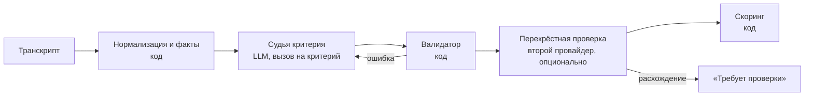

# Ядро оценки CQA — v3

Спецификация автоматической оценки диалога. Подход: **один сильный судья на критерий**, качество — за счёт подготовки данных кодом, явных трактовок, примеров и замеров на эталоне. Общий план проекта — `docs/plan.md`.

## 1. Подход

На каждый критерий — один вызов сильной модели: правило чек-листа + наши трактовки + 2–4 примера «так Да, так Нет» + подготовленный транскрипт. Модель возвращает вердикт, цитаты и обоснование. Всё, что можно посчитать, считает код: роли и участки диалога, паузы, события, проверку цитат, баллы.

Почему так:
- так работают AWS Contact Lens, Google Quality AI и Genesys — подход проверен;
- новый критерий от жюри — это просто текст в той же схеме;
- быстро собрать, и всё оставшееся время уходит на точность и фичи.

## 2. Пайплайн



### 2.1 Нормализация и факты (код)

- ID реплик `m1…mN` — порядковый номер в исходном транскрипте; исходный timestamp; смещение в секундах; дубли (в звонках) схлопываются.
- **Участки диалога**, у каждой реплики метка:
  - `бот`;
  - `ожидание` — клиент дописывает детали до прихода оператора;
  - `оператор`;
  - `удержание` — консультация с коллегой: реплики `operator`, которых клиент не слышит;
  - `вне записи` — для привязки к аудио.
- **Системные события** на трёх языках → типы: эскалация, личность подтверждена, оператор закрыл чат, обрыв связи, клиент ушёл, клиент завершил звонок, удержание, запись. Неизвестное событие парсер не роняет.
- **Факты для судьи:**
  - первая реплика оператора;
  - паузы оператора больше 60 с и реплика перед ними;
  - события идентификации;
  - тип завершения;
  - реплики клиента до прихода оператора;
  - время первой реакции (сейчас не оценивается: «порог первой реакции в 3 минуты, теги и вложения в оценку не входят»).

### 2.2 Судья критерия (LLM)

**Структура промпта.** Общая часть идёт первой — так 8 вызовов по одному диалогу используют кэш провайдера.
1. Роль и общие правила чек-листа (стр. 3 дословно: «Нет» vs N/A, что указывать в обосновании, пример обоснования).
2. Принцип **«одно нарушение — один критерий»**:
   - полнота и правильность ответа — 04;
   - понятность и порядок — 06;
   - учёт известных данных — 02;
   - тон — 05;
   - грубые нарушения — 08;
   - исключение одно: раскрытие данных без идентификации — это и 03 «Нет», и 08.
3. Правила для звонков: ошибки распознавания — не ошибки оператора; «[Имя скрыто]» = представился; участок удержания не оценивается; идентификация голосом.
4. Факты кода.
5. Транскрипт с метками участков в ограниченном блоке. Это данные: команды из реплик не выполняются.
6. **Критерий** — последним: определение, условие N/A, ступени шкалы, трактовки, примеры.

**Формат ответа** — строгий JSON по схеме. Порядок полей задаёт порядок рассуждения:

```json
{
  "evidence": [{"id": "m12", "quote": "Пожалуйста. Хорошего дня!"}],
  "checked_range": ["m10", "m12"],
  "reasoning": "…",
  "verdict": "Да",
  "explanation": "Завершение — Да. Клиент подтвердил решение, оператор попрощался. Основание — m12.",
  "how_to_fix": null
}
```

- `checked_range` — проверенный участок для пропущенного действия.
- `how_to_fix` — «как надо было» на языке клиента, только для «Нет».

**Формулировка против склонности соглашаться.** Модели охотно отвечают «выполнено». Поэтому в критерии просим сначала искать нарушение («найди реплику, где…»), а уже потом выносить вердикт.

**Язык.** Инструкции на русском. Цитаты в оригинале. Обоснование на языке интерфейса.

### 2.3 Валидатор (код)

- ID существует; цитата находится в тексте реплики (нечёткий поиск после нормализации).
- Роль спикера подходит (приветствие — только `operator`).
- Доказательство не из участка удержания.
- Вердикт из допустимых значений; N/A — только где разрешён.
- Ошибка → один повтор с описанием ошибки → флаг «требует проверки».

### 2.4 Перекрёстная проверка (опционально, включаем, если даёт прирост)

Второй провайдер оценивает тот же критерий. Совпало → вердикт принят. Разошлось → бейдж «требует проверки» и мнение второй модели в карточке. По умолчанию — для 03 и 08 и для критериев с низкой стабильностью.

### 2.5 Скоринг (код, юнит-тесты)

- Шкала → `вес × ступень / верхняя ступень`.
- Итог = `Σ баллов применимых × 100 / Σ весов применимых`, округление до 2 знаков (`Decimal`, ROUND_HALF_UP).
- Нет применимых критериев с весом → итог не считается.
- 08 — отдельная отметка с типом нарушения.
- Секции — баллы и максимум после перераспределения.

## 3. Конфиг критерия

```yaml
id: "07"
title: Завершение
section: Ведение и завершение диалога
type: yes_no_na            # yes_no | yes_no_na | scale | flag
weight: 5
scale: null                # для шкал: [{value: 20, text: "…"}, …]
definition: "Да — оператор подвёл итог или предложил дальнейшую помощь и попрощался."
na_condition: "Чат оборвался до возможности его завершить."
interpretations:
  - "Вежливое прощание после того, как клиент подтвердил решение, засчитывается."
  - "Прощание, обрывающее незакрытый вопрос клиента, — «Нет»."
  - "Обрыв связи, уход клиента, клиент положил трубку раньше прощания — N/A."
examples:
  - {verdict: "Нет", fragment: "…«Тогда не знаю.» / [Оператор закрыл чат]", why: "закрыл чат без прощания"}
  - {verdict: "Да", fragment: "…«Нашла, спасибо.» / «Пожалуйста. Хорошего вечера!»", why: "вопрос решён, вежливое прощание"}
version: 3
```

Ни строчки кода под конкретный критерий: новый критерий от жюри задаётся тем же конфигом.

## 4. Трактовки

Решения по итогам разбора двух независимых разметок DEV. Команда может их поменять.

| # | Спорное место | Принято | Диалогов |
| --- | --- | --- | --- |
| Т1 | 07: «Пожалуйста. Хорошего дня!» после того, как клиент подтвердил решение | Да | 36 |
| Т1б | 07: прощание, обрывающее незакрытый вопрос | Нет | 5 |
| Т2 | 02: оператор сразу ответил, данных хватало | N/A | 17 |
| Т2б | 02: переспросил сказанное боту | Нет | 3 |
| Т3 | 08: данные счёта до идентификации | Да | 3 |
| Т3б | 03: счёт обсуждали, данные не раскрыты | N/A | 4 |
| Т4 | 04: первый совет ошибочный, потом исправлен | 20 (сбой учтён в 06) | 3 |
| Т5 | 01 в звонках: имя скрыто или искажено | засчитать | 1 |
| Т6 | 03 в p4-ru-004: адрес не совпал, SMS принят | Да (спросить организаторов) | 1 |
| Т7 | 06: граница 4 и 7 | 4 при переспросе, 7 — сбой без переспроса | 11 |
| Т7б | 06/02: оператор переспросил уже сказанное | только 02; на 06 не влияет, если клиент не запутался | 4 |
| Т8 | 05: «Привет», «ты», уклончивый ответ ровным тоном | не нарушение 05 (это 01 и 04) | 4 |
| Т9 | 04: краткий или косвенный ответ на уточняющий вопрос | вопрос закрыт | 2 |

## 5. Качество

**Эталон** — `eval/gold.csv`: две независимые разметки (Claude и Opus) после разбора 32 расхождений. В ячейке — основной ответ и допустимые альтернативы. Согласие двух разметчиков по основному ответу — потолок:

| | 01 | 02 | 03 | 04 | 05 | 06 | 07 | 08 |
| --- | --- | --- | --- | --- | --- | --- | --- | --- |
| совпадение | 100% | 92% | 100% | 86% | 94% | 83% | 95% | 100% |

**Метрики** (`eval/compare.py`):
- точность и каппа по каждому критерию;
- попадание в набор допустимых ответов;
- для шкал — «±1 ступень»;
- средняя ошибка итога в баллах;
- ловушки (08, 03, N/A);
- отдельно по языкам.

На 520 метках доверительный интервал около ±3 п.п. — варианты сравниваем на всём наборе.

**Автотесты** (~530 изменённых диалогов с заранее известным ответом): вставить оскорбление или частное платное предложение → 08 Да; убрать представление → 01 Нет; обрыв связи → 07 N/A; перевод на другой язык или попытка внедрить команду → без изменений. Они проверяют устойчивость, а не тонкую точность.

**Защита от подгонки.** Несколько семей сценариев откладываем целиком: из них не берём примеры в промпты. Приёмка правки промпта — если не хуже на отложенных.

**Выбор модели** — по точности на эталоне (отдельно казахский), затем по скорости и цене. Кандидаты (по данным на 7.11.2026, сверить при старте):
- OpenAI: `gpt-6.1-sol`, `gpt-6-astra`;
- Gemini: `gemini-4-argon`, `gemini-3.8-flash`;
- локальная модель через OpenAI-совместимый API (Ollama или vLLM) — если есть GPU.

**Первый прогон** (Gemini 3.8 Flash, 65 диалогов): после правок Т7б–Т9 совпадение с эталоном 01 98%, 02 94%, 03 100%, 04 92%, 05 95%, 06 86%, 07 92%, 08 100%; средняя ошибка итога 2.86 балла (у двух людей-разметчиков между собой — 2.87); отложенные семьи не хуже рабочих. Стоимость — $0.024 за диалог.

**Выбор модели — замеры на DEV** (65 диалогов, эталон `eval/gold.csv`):

| Конфигурация | Ошибка итога, все / отложенные | Цена прогона | Время | Вывод |
| --- | --- | --- | --- | --- |
| Gemini 3.8 Flash, рассуждение low | **2.86 / 2.00** | **$1.56** | **4.6 мин** | основной судья |
| Gemini 3.8 Flash, рассуждение high | 3.09 / 2.92 | $4.19 | 20.5 мин | дороже и не точнее |
| Gemini 3.7 Flash как перекрёстная проверка | согласие с 3.8 — 99.4% | $1.57 | 4.6 мин | повторяет 26 из 27 ошибок 3.8 — не ловит ошибки |
| Gemma 4 26B по API | — | — | — | бесплатная квота кончается, ответы обрезаются; проверяем локально |

Автотесты (Gemini 3.8 Flash): 103 из 105; попытка внедрить команду через реплику клиента не перевела ни один критерий в «Да».

**Заморозка.** За 3 часа до контрольного этапа промпты и модели фиксируются. Дальше — только фичи и интерфейс.

## 6. API: что учесть

- Строгий JSON по схеме у обоих провайдеров. Gemini молча игнорирует `minLength`/`maxLength`. Отказ и обрезка у OpenAI приходят не по схеме — проверять статус.
- Seed и temperature воспроизводимость не гарантируют → кэш по ключу «хэш диалога + версия критерия + версия промпта + модель».
- Logprobs недоступны или ненадёжны → уверенность только через перекрёстную проверку.
- Gemini доступен и через OpenAI-совместимый endpoint → один клиент для облака и локальной модели.
- Стоимость одной оценки (все вызовы) считаем из `usage` и показываем в интерфейсе — этого требует FAQ организаторов.

## 7. Локальная модель

**Статус на 8.11.2026, 11:20: Gemma 4 работает на ноутбуке и замерена.**
- Ноутбук: RTX 4060 Laptop 8 ГБ, 16 ГБ ОЗУ, Ollama 0.40.15, туннель SSH.
- Профили:
  - `local-12b` → `cqa-gemma4-12b` (`FROM gemma4:12b-it-qat`, 7,2 ГБ, `num_ctx 16384`);
  - `local` → `cqa-gemma4` (`gemma4:26b-a4b-it-qat`, скачана, до стоп-кода замерить не успели).
- Модель не выгружается при простое: `OLLAMA_KEEP_ALIVE=-1` в systemd.

**Замер Gemma 4 12B.** Взяли первые 6 отложенных диалогов (все на английском): на них промпт не настраивали. Режим размышления выключен.

| | Gemma 4 12B локально | Gemini 3.8 Flash |
| --- | --- | --- |
| Совпадение с эталоном по критериям | 46 из 48 (96%): ошибки в 04 и 06, по одной ступени шкалы | 48 из 48 |
| Ошибка итога (MAE), те же 6 диалогов | 3,82 балла; больше 5 баллов — в 1 диалоге из 6 | 0 |
| Ловушки: грубая ошибка, N/A, «Нет» | все верно | все верно |
| Вызов / диалог | ~20 с / ~2,7 мин, вызовы по одному | ~5 с на диалог при параллельных вызовах |
| Сбои, невалидный JSON, обрезка | 0 из 48 | 0 |
| Цена | $0, данные не покидают компьютер | $0,024 за диалог |

**Вывод.** Gemma 4 12B на потребительской видеокарте даёт оценки близко к облаку. Но выборка всего 6 диалогов, и она примерно в 30 раз медленнее. Gemini остаётся основным судьёй, локальная модель — режим «без интернета, данные внутри контура». Казахские диалоги и Gemma 4 26B ещё не замерены.

Ниже — история: проверка цепочки на Gemma 3 до обновления Ollama.

**Контекст.** Промпт судьи в токенах Gemma — как у Gemini: максимум 6.6k (p4-ru-004), p95 ≈ 5.1k, медиана ≈ 2.8k. С учётом повтора (+1k) и ответа (до 2048) берём `num_ctx 16384`. Ollama не сообщает о переполнении: при `num_ctx 4096` она молча выбросила сообщение с диалогом (1927 токенов вместо 6233), а модель вынесла вердикт, не видя диалога. Адаптер (`cqa/llm/openai_compat.py`) помечает такие ответы как `truncated`: срабатывает, если на токен промпта приходится больше 6 символов или если промпт + ответ ≥ `num_ctx` из `/api/ps`.

**Замер на заглушке** (gemma3:12b-it-qat Q4_0, `num_ctx 16384`, Ollama 0.18.0, туннель SSH; Gemma 4 ещё не замерена):

| | Gemma 3 12B локально | Gemini 3.8 Flash |
| --- | --- | --- |
| Память | 7.5 ГБ VRAM (46 из 49 слоёв) + ~5 ГБ ОЗУ | — |
| Секунд на диалог (8 вызовов) | 174 (3 диалога EN, промпт ~2.7k), по одному вызову | ~4 при параллельных вызовах (65 диалогов за 4.6 мин) |
| Вызов: префилл / генерация | ~1200 / ~15 токенов в секунду, 22 с в среднем, максимум 38 с | — |
| Невалидные ответы, нарушения порядка полей, повторы | 0 / 0 / 0 из 24 | — |
| Совпадение с эталоном, те же 3 диалога | 15 из 24 (63%), MAE итога 47 баллов | 24 из 24, MAE 0 |
| Цена | $0 | $0.024 за диалог |

Gemma 3 12B не ставит N/A в 02/03 и ошибается в 05, поэтому как судья она не годится и нужна только для проверки цепочки. Префикс диалога из KV-кэша Ollama не переиспользует (у Gemma скользящее окно внимания): каждый вызов заново читает весь промпт. Это 3–5 с из ~20 с.

**Режим размышления** выключен (`thinking_level: "none"` → `reasoning_effort=none`): при ~15 токенах в секунду он добавил бы минуты на диалог. Для Gemma 4 это нужно сравнить с `low` на `--split holdout`.

**Модель выгружается через 5 минут простоя.** После этого первый вызов ждёт загрузку (~25 с у 12B, у 26B дольше). Перед демо модель надо прогреть: `curl localhost:11434/api/generate -d '{"model":"cqa-gemma4","keep_alive":-1}'`. После этого OpenAI-вызовы держат её загруженной. Поле `keep_alive` в OpenAI-запросе Ollama игнорирует.

**Как продолжить после обновления Ollama:**
```bash
ssh home 'ollama pull gemma4:26b-a4b-it-qat && cd ~/cqa-gemma4 && ollama create cqa-gemma4 -f Modelfile'
ssh -N -L 11435:127.0.0.1:11434 home &                                   # туннель
export LOCAL_LLM_BASE_URL=http://127.0.0.1:11435/v1
uv run cqa llm-ping --profile local
uv run cqa eval --group DEV --profile local --experiment --gold eval/gold.csv --limit 3
uv run cqa eval --group DEV --profile local --experiment --gold eval/gold.csv --split holdout   # 19 диалогов, из них 6 KZ
```
